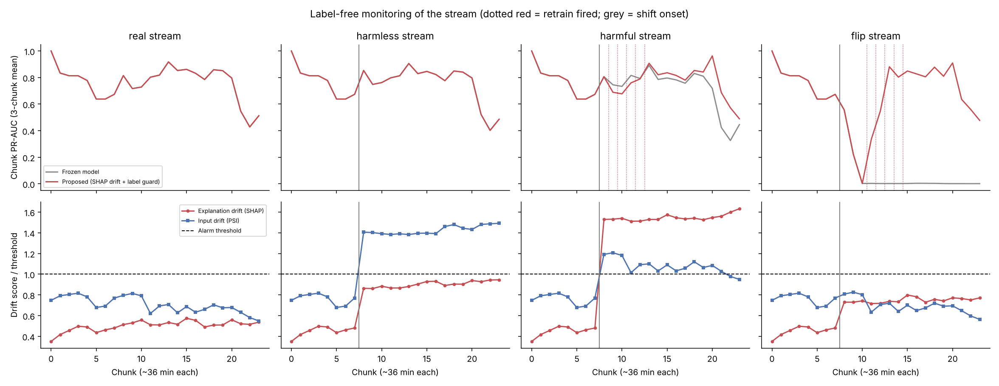
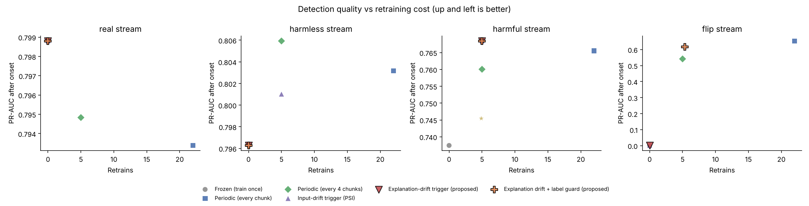
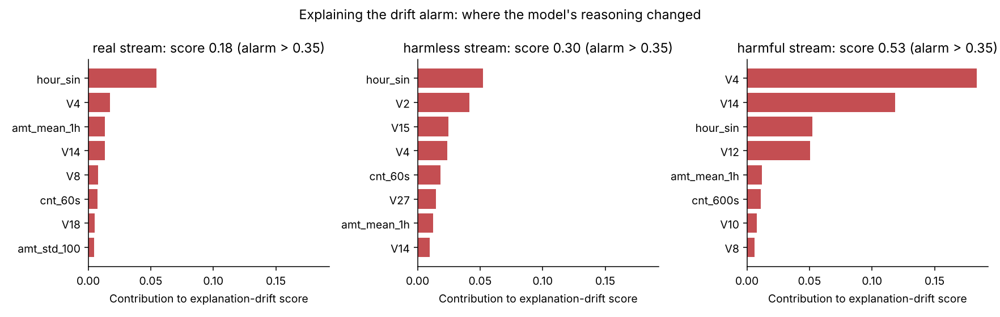
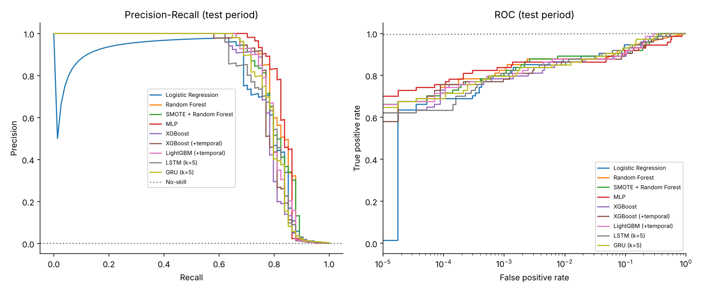
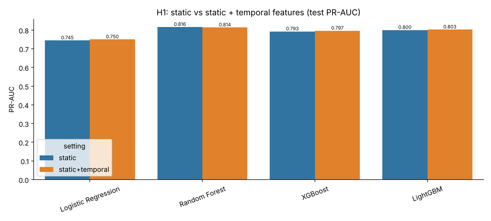
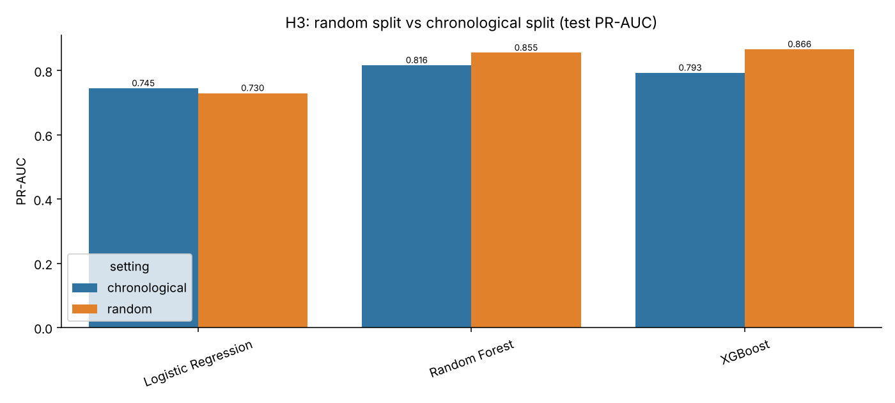
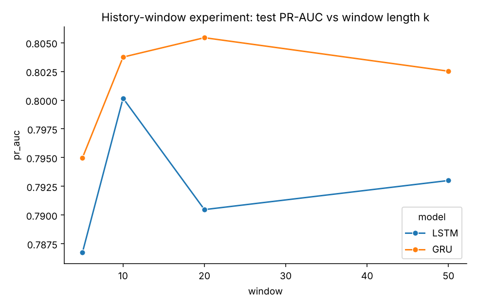
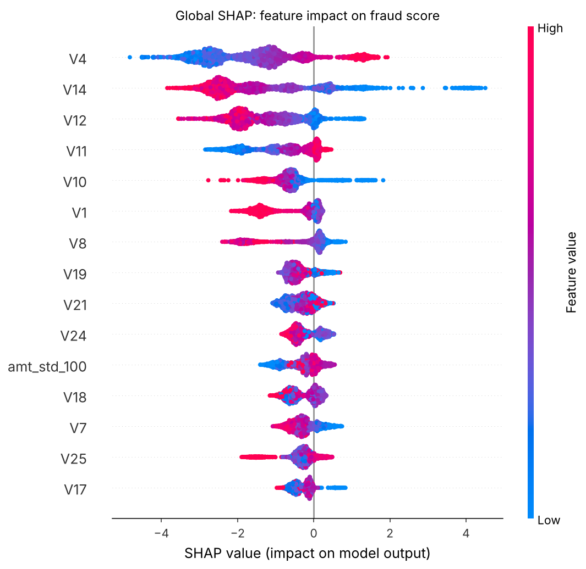
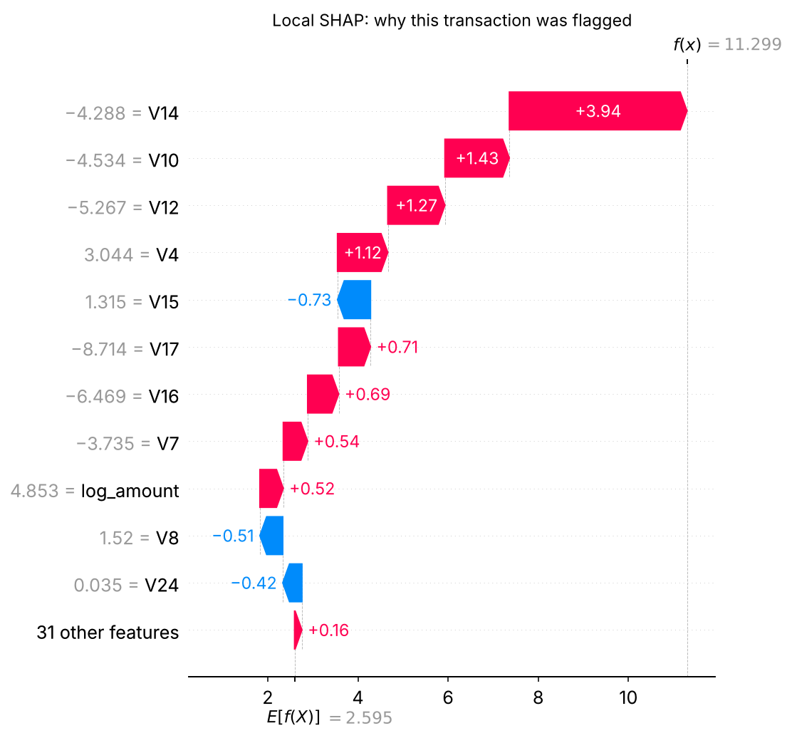

# Temporal and Explainable Machine Learning for Early Financial Fraud Detection

T.Y. B.Tech Information Technology · AI Laboratory research project

A complete, leakage-free implementation that compares transaction-level, temporal and sequence (LSTM/GRU)
models for credit-card fraud detection on the ULB European Credit Card dataset (284,807 transactions,
492 frauds, 0.172 %), with SHAP explanations, threshold analysis, drift analysis and a Streamlit dashboard.

All numbers below were produced by `run_experiments.py` on the real dataset (3 random seeds, 16 min on a 4-core CPU).
Full tables: [`reports/RESULTS.md`](reports/RESULTS.md). Method: [`docs/METHODOLOGY.md`](docs/METHODOLOGY.md).

## Quick start

```bash
pip install -r requirements.txt
python run_experiments.py        # downloads data/creditcard.csv if missing, runs all 8 experiments
streamlit run app.py             # dashboard: dataset, results, live scoring with SHAP
pytest -q                        # leakage and metric tests
```

`python run_novelty.py` runs the novelty experiment below (about 100 min for 3 seeds; `--quick` uses 1 seed,
`--analyse-only` rebuilds tables and figures from saved CSVs).

`python run_experiments.py --quick` runs one seed and fewer sequence windows. In Google Colab, upload the repo
(or `git clone` it), then run the same commands with a leading `!`.

## Project structure

```
src/fraud/
  config.py      paths, seeds, split ratios, feature groups, cost model
  data.py        download, audit, duplicate removal, chronological and random splits
  features.py    static, past-only temporal, and per-entity behavioral features
  models.py      LR, SMOTE-LR, RF, SMOTE-RF, XGBoost, LightGBM, MLP, imbalance variants
  sequence.py    LSTM / GRU over the last k transactions (PyTorch)
  evaluate.py    PR-AUC, ROC-AUC, F1, FPR, cost; validation-based thresholds; drift windows
  explain.py     SHAP global (summary, bar) and local (waterfall) explanations
  plots.py       figures
  adaptive.py    novelty: SHAP explanation-drift monitor, input-drift (PSI) baseline, streaming replay
run_experiments.py   runs every experiment and writes results/ and reports/RESULTS.md
run_novelty.py       novelty experiment, writes results/novelty_* and reports/NOVELTY.md
app.py               Streamlit dashboard
tests/               leakage tests (past-only features, no split overlap) and metric tests
results/             CSV tables, summary.json, figures/
models/              saved XGBoost (+temporal) model used by the dashboard
docs/METHODOLOGY.md  research design, hypotheses, leakage controls
demo/index.html      browser-only interactive explainer (no install needed)
```

## Pipeline

Raw data → audit → remove 1,081 duplicates → sort by time → **chronological 60/20/20 split** → static + past-only
temporal features → models (scaling and SMOTE inside pipelines, fit on train only) → **threshold chosen on validation**
→ single evaluation of the test period → drift, ablation, SHAP.

| Split | Rows | Fraud | Hours |
|---|---|---|---|
| Train | 170,235 | 342 | 0.0 – 33.4 |
| Validation | 56,745 | 57 | 33.4 – 40.3 |
| Test | 56,746 | 74 | 40.3 – 48.0 |

## Results (test period, mean over 3 seeds)

| Model | PR-AUC | ROC-AUC | Precision | Recall | F1 |
|---|---|---|---|---|---|
| Logistic Regression | 0.7447 | 0.9811 | 0.960 | 0.649 | 0.774 |
| SMOTE + Logistic Regression | 0.7574 | 0.9792 | 0.980 | 0.649 | 0.781 |
| **Random Forest** | **0.8165** | 0.9614 | 0.885 | 0.757 | 0.816 |
| SMOTE + Random Forest | 0.8143 | 0.9734 | 0.876 | 0.730 | 0.796 |
| XGBoost | 0.7929 | 0.9733 | 0.896 | 0.739 | 0.810 |
| LightGBM | 0.8003 | 0.9838 | 0.907 | 0.743 | 0.817 |
| MLP | 0.7935 | 0.9671 | 0.835 | 0.725 | 0.775 |
| LSTM (k=5) * | 0.7867 | 0.9767 | 0.958 | 0.622 | 0.754 |
| GRU (k=5) * | 0.7950 | 0.9820 | 0.927 | 0.689 | 0.791 |

\* single seed; history window k chosen on validation PR-AUC (all windows: [`results/sequence_models.csv`](results/sequence_models.csv)). The final model chosen on **validation** PR-AUC is XGBoost (test: 55 of 74 frauds caught, 7 false alarms).

## Findings for each hypothesis

| | Result |
|---|---|
| **H1** temporal features help | **Small / mixed.** PR-AUC XGBoost 0.793 → 0.797, LightGBM 0.800 → 0.803, LR 0.745 → 0.750; RF 0.817 → 0.814. On ULB the temporal features describe the global stream because there is no card ID, so most of the signal is already in V1–V28. |
| **H2** LSTM/GRU add value | **Comparable, not better.** At the validation-chosen window (k=5) GRU scores 0.795 and LSTM 0.787 test PR-AUC, similar to the tree models; across all windows GRU ranges 0.795–0.805 and LSTM 0.787–0.800. Gains need real per-card sequences (IEEE-CIS). |
| **H3** random split is optimistic | **Supported.** XGBoost PR-AUC 0.866 on a random split vs 0.793 chronological; RF 0.855 vs 0.817. |
| **H4** PR-AUC > accuracy / ROC-AUC | **Supported.** "All legit" scores 99.83 % accuracy with 0 recall. RF has the lowest ROC-AUC (0.961) of the tree models but the highest PR-AUC (0.817). |
| **H5** best AUC ≠ best operating point | **Supported.** For the final model, the max-F1 threshold catches 55 frauds with 7 false alarms; the min-cost threshold catches 58 with 41; a ≥85 % recall target catches 64 but raises 478 alarms. |

**Other results**
- **History window:** for GRU, test PR-AUC rises from k=5 (0.795) to k=20 (0.805) and then levels off at k=50 (0.803). Validation PR-AUC is flat (0.770–0.780) and picks k=5, so the test-period gain from longer windows is not used for selection.
- **Class imbalance (XGBoost):** class weighting, SMOTE and no reweighting are within 0.001 PR-AUC of each other. Undersampling is the worst (0.784).
- **Drift:** every model loses PR-AUC in the last third of the test period (XGBoost 0.84 → 0.53). That third contains only 12 frauds, so treat this as an indication rather than a firm result.
- **SHAP:** explained on XGBoost (+temporal), not the selected plain XGBoost, so that the temporal features can be inspected too. The two are close (3-seed mean test PR-AUC 0.793 vs 0.797). Top features: V4, V14, V12, V11 and V10, which match the published benchmark.

## Novelty: explanation-drift-triggered retraining (H6)

**Problem.** Our drift experiment shows that performance moves over the test period, but a deployed fraud model
cannot see that in time. Labels (chargebacks, analyst verdicts) arrive late, so label-based monitoring reacts
late. Classic label-free monitoring compares *input* distributions (PSI), which also fires when fields the
model ignores change, causing needless retrains.

**Idea.** Monitor the model's own **SHAP explanations** of incoming, still-unlabelled transactions. If the way
the model reasons about the stream changes, retrain; if only irrelevant inputs change, stay quiet. The method
(`src/fraud/adaptive.py`) has three parts:

1. **Explanation-drift score.** For each chunk of new transactions,
   `D = Σ_j W1(SHAP_ref_j, SHAP_chunk_j) / Σ_j E|SHAP_ref_j|`, the share of the model's attribution mass that
   has moved (W1 = 1-D Wasserstein distance). The alarm threshold is the 90th percentile of D over the most
   recent training chunks, so it is set without labels and without looking at the future.
2. **Alarm-then-adapt retraining.** With delayed labels, retraining right after an alarm does not help,
   because the drifted chunk's own labels are not known yet. An alarm therefore opens a short adaptation
   window (4 chunks) in which the model is retrained whenever new labels arrive.
3. **Delayed-label guard.** When a chunk's labels arrive and the deployed model caught significantly fewer
   than half of its frauds (one-sided binomial test, α = 0.05), that also raises an alarm. This covers concept
   drift that leaves unlabelled data looking normal.

Each alarm also comes with an explanation: the per-feature split of D shows which features' attributions moved.

**Protocol.** The model is trained on the training period. The validation and test periods (113,491
transactions, 131 frauds) are replayed as 24 chunks of about 36 minutes. Each chunk is scored before its labels
exist, and labels arrive one chunk late. We test four streams: the **real** stream, plus three controlled shifts
starting at chunk 8. In **harmless**, the 10 features the model relies on least move by +2 SD. In **harmful**,
the 3 it relies on most (V14, V4, V12) move by +3 SD. In **flip**, the sign of those 3 features flips. We compare
against a frozen model, periodic retraining, a PSI trigger, and retraining at random times with the same number
of retrains. Everything uses XGBoost (static + temporal) and 3 seeds.

**Results** (PR-AUC after the shift onset, mean of 3 seeds; full tables in [`reports/NOVELTY.md`](reports/NOVELTY.md))

| Stream | Frozen | Retrain every chunk (22) | Every 4 chunks (5) | PSI trigger | **Proposed** (SHAP drift + label guard) |
|---|---|---|---|---|---|
| real | 0.799 | 0.793 | 0.795 | 0.799 (0 retrains) | **0.799 (0 retrains)** |
| harmless | 0.796 | 0.803 | 0.806 | 0.801 (5, false alarm) | **0.796 (0 retrains, no false alarm)** |
| harmful | 0.737 | 0.766 | 0.760 | 0.768 (5) | **0.768 (5)**; random timing with 5 retrains: 0.745 |
| flip | 0.001 | 0.654 | 0.542 | 0.001 (never fires) | **0.618 (5.3)** |

**What this shows**
- **No false alarms:** on the real stream and the harmless shift, the explanation monitor never fires. PSI
  fires on every chunk after the harmless shift.
- **Efficient when it matters:** after the harmful shift, 5 well-timed retrains recover more than retraining
  every chunk (0.768 vs 0.766 with 22 retrains). Retraining 5 times at random moments recovers less (0.745),
  so the timing comes from the monitor, not from retraining in general.
- **The label guard closes the blind spot.** Flipping the top features makes fraud invisible to the frozen
  model (PR-AUC 0.001), while the unlabelled data still looks normal to both label-free monitors. The guard
  catches it once labels arrive and recovers to 0.618 with about 5 retrains. Retraining every 4 chunks, at the
  same cost, reaches 0.542.
- **Explained alarms:** on the harmful stream, V4, V14 and V12 carry most of the drift score
  (`novelty_drift_attribution.png`). On the real stream, the largest contributor is `hour_sin`, the day/night
  cycle, which is natural and stays below the threshold.

**Why it is novel.** Explanation shift as a drift measure was proposed by Mougan et al. (2023). As far as we know,
nobody has used it as a **retraining trigger for fraud detection under delayed labels**, or combined it with
alarm-then-adapt retraining and a statistical delayed-label guard. Nor has it been evaluated against PSI,
periodic and random-timing baselines on harmless, harmful and concept-drift streams.

**Honest limits.** On the real two-day stream there is no drift worth acting on: retraining every chunk does
not beat the frozen model, so the monitor's value there is that it saves the retraining cost. The shift
scenarios are controlled stress tests, and they were designed after a first run showed the real stream has no
drift worth acting on. The alarm-then-adapt window and the label guard were added after a first version that
retrained only once adapted too slowly, and after the flip scenario exposed the blind spot. On the harmful
stream the PSI trigger performs the same as the proposed trigger; the difference is that PSI also raises false
alarms on irrelevant fields.





## Figures

| | |
|---|---|
|  |  |
|  |  |
|  |  |

## Notes and limitations

- LightGBM with a large `scale_pos_weight` diverged on this data (validation PR-AUC ≈ 0.01). Its settings (no reweighting, stronger leaf regularization) were chosen on the validation period.
- `add_behavioral_features` (per-card history) is implemented and unit-tested, but ULB has no card ID, so it is meant for IEEE-CIS.
- The ULB features are anonymized PCA components and the data covers only two days.
- SHAP shows what the model relied on, not what caused the fraud.

## Tech stack

Python, pandas, NumPy, scikit-learn, imbalanced-learn, XGBoost, LightGBM, PyTorch, SHAP, Matplotlib, Seaborn, Streamlit, pytest.

## References

Dal Pozzolo et al., *Calibrating Probability with Undersampling for Unbalanced Classification*, IEEE SSCI 2015 ·
Lundberg & Lee, *A Unified Approach to Interpreting Model Predictions*, NeurIPS 2017 ·
Mougan et al., *Explanation Shift: How Did the Distribution Shift Impact the Model?*, 2023 ·
Gama et al., *A Survey on Concept Drift Adaptation*, ACM Computing Surveys 2014 ·
Motie & Raahemi, *Financial fraud detection using graph neural networks: a systematic review*, ESWA 2024 ·
ULB / Worldline Credit Card Fraud Detection dataset · IEEE-CIS Fraud Detection dataset.
