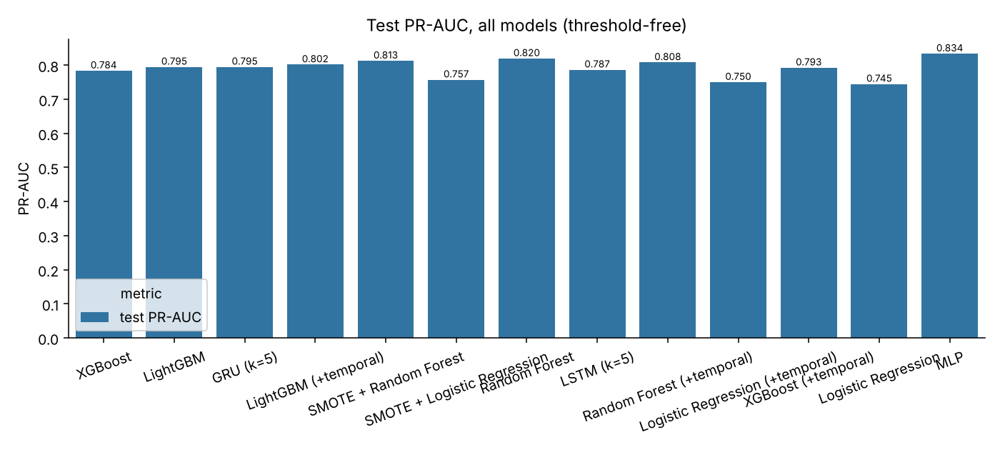
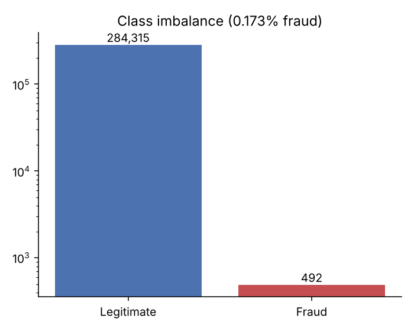
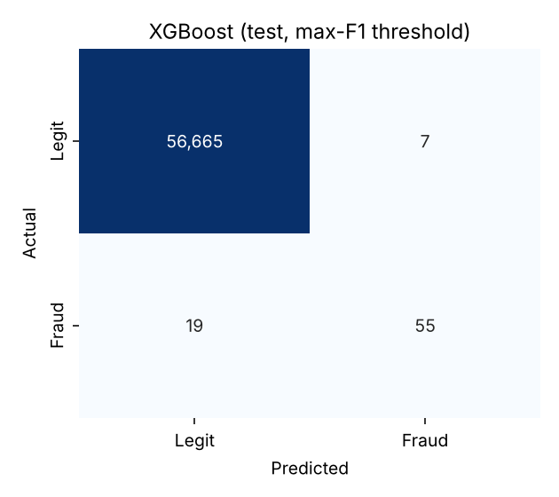
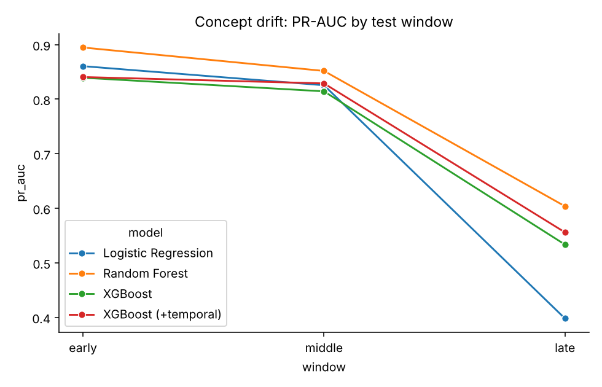
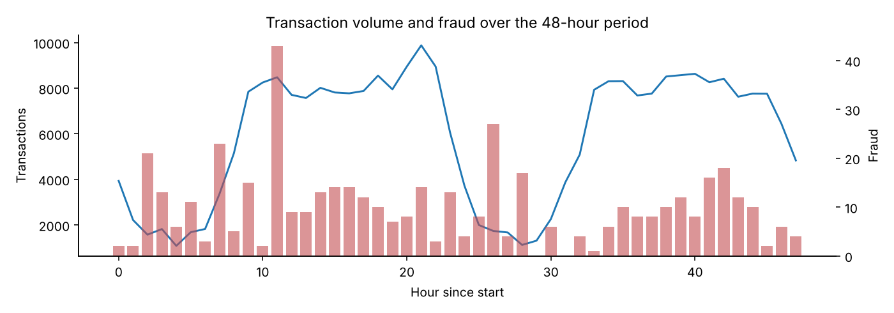
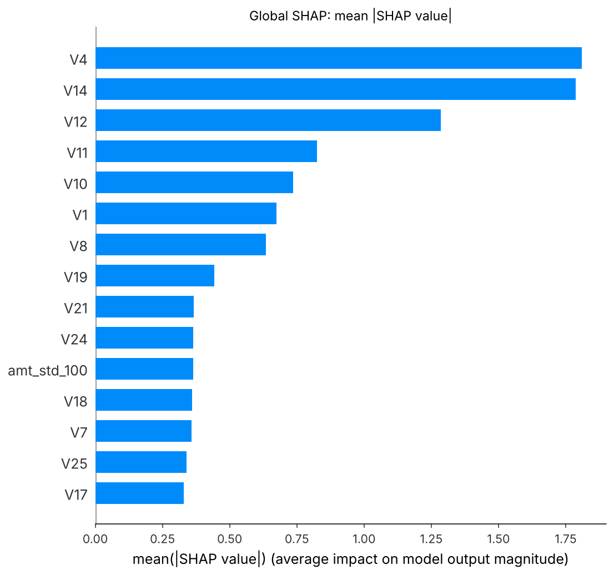

# Experiment Results
Generated by `run_experiments.py` (seeds: [42, 7, 2024], runtime 16.1 min). All test numbers use a threshold chosen on the validation period; the test period is evaluated once.
## 1. Dataset audit
- Raw: 284,807 transactions, 492 fraud (0.173%), 0 missing values, 48.0 hours.
- Removed 1,081 exact duplicates (19 fraud) -> 283,726 rows, 473 fraud.
- Predicting 'legitimate' for everything gives 99.8273% accuracy and 0 recall, so accuracy is not used for selection.

### Chronological split (60/20/20)
| split | rows | fraud | fraud_rate | time_start_h | time_end_h |
|---|---|---|---|---|---|
| train | 170235 | 342 | 0.201% | 0.0 | 33.4 |
| validation | 56745 | 57 | 0.100% | 33.4 | 40.3 |
| test | 56746 | 74 | 0.130% | 40.3 | 48.0 |

## 2. Baseline models (static features, chronological split, mean ± std over seeds)
Metric columns are means over seeds; tp / fn / fp are from the first seed.

| model | PR-AUC | ROC-AUC | precision_mean | recall_mean | f1_mean | tp | fn | fp |
|---|---|---|---|---|---|---|---|---|
| Logistic Regression | 0.7447 ± 0.0000 | 0.9811 ± 0.0000 | 0.9600 | 0.6486 | 0.7742 | 48 | 26 | 2 |
| SMOTE + Logistic Regression | 0.7574 ± 0.0002 | 0.9792 ± 0.0002 | 0.9796 | 0.6486 | 0.7805 | 48 | 26 | 1 |
| Random Forest | 0.8165 ± 0.0024 | 0.9614 ± 0.0084 | 0.8846 | 0.7568 | 0.8156 | 56 | 18 | 7 |
| SMOTE + Random Forest | 0.8143 ± 0.0012 | 0.9734 ± 0.0051 | 0.8760 | 0.7297 | 0.7961 | 54 | 20 | 8 |
| XGBoost | 0.7929 ± 0.0066 | 0.9733 ± 0.0011 | 0.8962 | 0.7387 | 0.8099 | 55 | 19 | 7 |
| LightGBM | 0.8003 ± 0.0045 | 0.9838 ± 0.0004 | 0.9067 | 0.7432 | 0.8167 | 56 | 18 | 6 |
| MLP | 0.7935 ± 0.0285 | 0.9671 ± 0.0091 | 0.8346 | 0.7252 | 0.7746 | 56 | 18 | 4 |

## 3. H1 - Static vs static + temporal features
| model | setting | pr_auc_mean | pr_auc_std | roc_auc_mean | recall_mean | precision_mean | f1_mean |
|---|---|---|---|---|---|---|---|
| Logistic Regression | static | 0.7447 | 0.0000 | 0.9811 | 0.6486 | 0.9600 | 0.7742 |
| Logistic Regression | static+temporal | 0.7502 | 0.0000 | 0.9832 | 0.6351 | 0.9592 | 0.7642 |
| Random Forest | static | 0.8165 | 0.0024 | 0.9614 | 0.7568 | 0.8846 | 0.8156 |
| Random Forest | static+temporal | 0.8139 | 0.0044 | 0.9458 | 0.7523 | 0.8799 | 0.8108 |
| XGBoost | static | 0.7929 | 0.0066 | 0.9733 | 0.7387 | 0.8962 | 0.8099 |
| XGBoost | static+temporal | 0.7966 | 0.0040 | 0.9745 | 0.7207 | 0.9358 | 0.8141 |
| LightGBM | static | 0.8003 | 0.0045 | 0.9838 | 0.7432 | 0.9067 | 0.8167 |
| LightGBM | static+temporal | 0.8029 | 0.0014 | 0.9806 | 0.7117 | 0.9141 | 0.8000 |

## 4. H3 - Random vs chronological split
| model | setting | pr_auc_mean | roc_auc_mean | recall_mean | f1_mean |
|---|---|---|---|---|---|
| Logistic Regression | chronological | 0.7447 | 0.9811 | 0.6486 | 0.7742 |
| Logistic Regression | random | 0.7297 | 0.9623 | 0.7474 | 0.8114 |
| Random Forest | chronological | 0.8165 | 0.9614 | 0.7568 | 0.8156 |
| Random Forest | random | 0.8554 | 0.9634 | 0.7684 | 0.8472 |
| XGBoost | chronological | 0.7929 | 0.9733 | 0.7387 | 0.8099 |
| XGBoost | random | 0.8663 | 0.9740 | 0.7895 | 0.8721 |

## 5. Class-imbalance strategies (XGBoost, static + temporal)
| strategy | pr_auc_mean | pr_auc_std | roc_auc_mean | precision_mean | recall_mean | f1_mean |
|---|---|---|---|---|---|---|
| None | 0.7961 | 0.0061 | 0.9765 | 0.9005 | 0.7342 | 0.8087 |
| Class weighting | 0.7966 | 0.0040 | 0.9745 | 0.9358 | 0.7207 | 0.8141 |
| SMOTE | 0.7962 | 0.0016 | 0.9668 | 0.9532 | 0.7297 | 0.8263 |
| Undersampling | 0.7844 | 0.0050 | 0.9851 | 0.9148 | 0.6892 | 0.7851 |

## 6. Sequence models and history window (LSTM / GRU over the last k transactions)
| model | window | val_pr_auc | pr_auc | roc_auc | precision | recall | f1 |
|---|---|---|---|---|---|---|---|
| LSTM | 5 | 0.7645 | 0.7867 | 0.9767 | 0.9583 | 0.6216 | 0.7541 |
| LSTM | 10 | 0.7632 | 0.8002 | 0.9594 | 0.9792 | 0.6351 | 0.7705 |
| LSTM | 20 | 0.7622 | 0.7905 | 0.9622 | 0.9400 | 0.6351 | 0.7581 |
| LSTM | 50 | 0.7633 | 0.7930 | 0.9615 | 0.9400 | 0.6351 | 0.7581 |
| GRU | 5 | 0.7795 | 0.7950 | 0.9820 | 0.9273 | 0.6892 | 0.7907 |
| GRU | 10 | 0.7794 | 0.8037 | 0.9824 | 0.9630 | 0.7027 | 0.8125 |
| GRU | 20 | 0.7780 | 0.8054 | 0.9830 | 0.9811 | 0.7027 | 0.8189 |
| GRU | 50 | 0.7703 | 0.8025 | 0.9828 | 0.9455 | 0.7027 | 0.8062 |

## 7. All models (ranked by validation PR-AUC)
Single run (first seed) of every model, including the best LSTM/GRU window chosen on validation.

| model | val_pr_auc | pr_auc | roc_auc | precision | recall | f1 | tp | fn | fp |
|---|---|---|---|---|---|---|---|---|---|
| XGBoost | 0.7822 | 0.7838 | 0.9749 | 0.8871 | 0.7432 | 0.8088 | 55 | 19 | 7 |
| LightGBM | 0.7817 | 0.7949 | 0.9834 | 0.9032 | 0.7568 | 0.8235 | 56 | 18 | 6 |
| GRU (k=5) | 0.7795 | 0.7950 | 0.9820 | 0.9273 | 0.6892 | 0.7907 | 51 | 23 | 4 |
| LightGBM (+temporal) | 0.7789 | 0.8019 | 0.9796 | 0.9273 | 0.6892 | 0.7907 | 51 | 23 | 4 |
| SMOTE + Random Forest | 0.7698 | 0.8129 | 0.9747 | 0.8710 | 0.7297 | 0.7941 | 54 | 20 | 8 |
| SMOTE + Logistic Regression | 0.7667 | 0.7574 | 0.9793 | 0.9796 | 0.6486 | 0.7805 | 48 | 26 | 1 |
| Random Forest | 0.7654 | 0.8198 | 0.9625 | 0.8889 | 0.7568 | 0.8175 | 56 | 18 | 7 |
| LSTM (k=5) | 0.7645 | 0.7867 | 0.9767 | 0.9583 | 0.6216 | 0.7541 | 46 | 28 | 2 |
| Random Forest (+temporal) | 0.7602 | 0.8082 | 0.9380 | 0.8615 | 0.7568 | 0.8058 | 56 | 18 | 9 |
| Logistic Regression (+temporal) | 0.7595 | 0.7502 | 0.9832 | 0.9592 | 0.6351 | 0.7642 | 47 | 27 | 2 |
| XGBoost (+temporal) | 0.7571 | 0.7927 | 0.9724 | 0.9455 | 0.7027 | 0.8062 | 52 | 22 | 3 |
| Logistic Regression | 0.7540 | 0.7447 | 0.9811 | 0.9600 | 0.6486 | 0.7742 | 48 | 26 | 2 |
| MLP | 0.7484 | 0.8338 | 0.9574 | 0.9333 | 0.7568 | 0.8358 | 56 | 18 | 4 |

Final model selected on validation: **XGBoost**.

## 8. H5 - Operating thresholds for the final model
| rule | threshold | precision | recall | f1 | tp | fn | fp | cost |
|---|---|---|---|---|---|---|---|---|
| Max F1 | 0.9409 | 0.8871 | 0.7432 | 0.8088 | 55 | 19 | 7 | 1,935 |
| Min expected cost | 0.1921 | 0.5859 | 0.7838 | 0.6705 | 58 | 16 | 41 | 1,805 |
| High precision (>=90%) | 0.9409 | 0.8871 | 0.7432 | 0.8088 | 55 | 19 | 7 | 1,935 |
| High recall (>=85%) | 0.0094 | 0.1181 | 0.8649 | 0.2078 | 64 | 10 | 478 | 3,390 |
| Default 0.5 | 0.5000 | 0.7671 | 0.7568 | 0.7619 | 56 | 18 | 17 | 1,885 |
| Review capacity top 0.2% | 0.1412 | 0.5133 | 0.7838 | 0.6203 | 58 | 16 | 55 | 1,875 |

## 9. Concept drift across the test period
| model | window | fraud | pr_auc | roc_auc | recall | precision |
|---|---|---|---|---|---|---|
| Logistic Regression | early | 31 | 0.8606 | 0.9942 | 0.6774 | 0.9545 |
| Logistic Regression | middle | 31 | 0.8256 | 0.9825 | 0.7419 | 1.0000 |
| Logistic Regression | late | 12 | 0.3980 | 0.9546 | 0.3333 | 0.8000 |
| Random Forest | early | 31 | 0.8948 | 0.9788 | 0.7742 | 1.0000 |
| Random Forest | middle | 31 | 0.8518 | 0.9717 | 0.8065 | 1.0000 |
| Random Forest | late | 12 | 0.6038 | 0.8988 | 0.5833 | 0.5000 |
| XGBoost | early | 31 | 0.8394 | 0.9888 | 0.7419 | 0.9200 |
| XGBoost | middle | 31 | 0.8144 | 0.9640 | 0.8065 | 1.0000 |
| XGBoost | late | 12 | 0.5335 | 0.9682 | 0.5833 | 0.5833 |
| XGBoost (+temporal) | early | 31 | 0.8406 | 0.9852 | 0.7419 | 0.9583 |
| XGBoost (+temporal) | middle | 31 | 0.8290 | 0.9720 | 0.7419 | 1.0000 |
| XGBoost (+temporal) | late | 12 | 0.5559 | 0.9460 | 0.5000 | 0.7500 |

## 10. Top SHAP features (XGBoost + temporal)
| feature | mean_abs_shap |
|---|---|
| V4 | 1.8103 |
| V14 | 1.7876 |
| V12 | 1.2845 |
| V11 | 0.8241 |
| V10 | 0.7360 |
| V1 | 0.6740 |
| V8 | 0.6358 |
| V19 | 0.4431 |
| V21 | 0.3669 |
| V24 | 0.3652 |

## Figures

